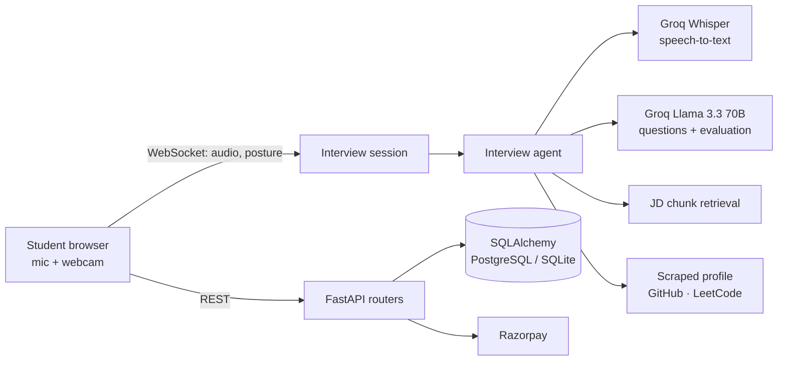

# PlacePrep AI — Backend

> 🏆 **1st Prize, Agentic AI Competition — IIST Indore**

PlacePrep AI is an AI mock-interview platform for college placements. A student uploads their resume and picks a job description; an LLM interviewer then runs a live, voice-based interview that adapts every question to the student's previous answer, the job description and their public GitHub / LeetCode profile. At the end the student gets a scored report on technical depth, communication and body language.

This repository is the **FastAPI backend**. The React frontend lives in [PlacePrepAi-Frontend](https://github.com/Aditya17452/PlacePrepAi-Frontend).

---

## What the backend does

- **Adaptive interview agent** — runs a structured interview (warm-up → technical → closing, 7–12 questions, ~20 minutes) over a WebSocket. Each follow-up question is generated by Llama 3.3 70B on Groq using the candidate's last answer, the relevant JD requirements and their scraped profile. It avoids repeated questions and detects empty or uninformative answers.
- **Speech-to-text** — candidate audio is transcribed with Whisper large-v3 on Groq.
- **JD context retrieval** — job descriptions are split into chunks and the chunks most relevant to the candidate's answer are injected into the next prompt.
- **Profile scraping** — links found in the resume are classified and scraped: GitHub profiles and repos (via the GitHub REST API, including READMEs) and LeetCode stats (via LeetCode's GraphQL endpoint). The summary grounds project-specific questions.
- **Live feedback and evaluation** — periodic in-interview feedback, filler-word tracking and webcam posture signals from the frontend; a final LLM evaluation returns technical, communication, body-language and overall scores with per-topic feedback.
- **Multi-role platform** — students, college placement officers (view students, shortlist candidates, manage credits) and a super admin (college enrolment, platform stats).
- **Credits and payments** — interview credits with Razorpay order creation and signature verification.
- **Auth** — email/password with JWT, plus Google OAuth.

## Architecture



## Tech stack

Python · FastAPI · WebSockets · SQLAlchemy · PostgreSQL / SQLite · Groq (Llama 3.3 70B, Whisper large-v3) · BeautifulSoup · PyJWT · Google OAuth · Razorpay · Render

## API overview

| Area | Endpoints |
|---|---|
| Auth | `POST /api/auth/register`, `POST /api/auth/login`, `GET /api/auth/me`, `GET /api/auth/google` |
| Resume | `POST /api/resume/upload`, `GET /api/resume/jds` |
| Job descriptions | `POST /api/jd/submit`, `GET /api/jd/list/{student_id}`, `GET /api/jd/status/{jd_id}` |
| Interview | `POST /api/interviews/start`, `WS /ws/interview/{session_id}`, `POST /api/interviews/{id}/end`, `GET /api/interviews/{id}/report`, `GET /api/interviews/history/{student_id}` |
| Credits & payments | `GET /api/credits/{student_id}`, `GET /api/payments/packages`, `POST /api/payments/create-order`, `POST /api/payments/verify` |
| Placement officer | `GET /api/officer/students`, `POST /api/officer/shortlist`, `GET /api/officer/credits` |
| Super admin | `GET /api/super/stats`, `GET /api/super/colleges`, `POST /api/super/colleges/enroll` |

Full interactive docs are at `/docs` when the server is running.

## Project structure

```
.
├── main.py                 app entry point, router registration
├── agents/
│   └── interview_agent.py  question generation, live feedback, final evaluation
├── api/                    routers: auth, resume, JD, interviews, credits, payments, officer, super admin
├── services/
│   ├── whisper_service.py  speech-to-text
│   ├── rag_service.py      JD chunk retrieval
│   ├── resume_scraper.py   GitHub / LeetCode / portfolio scraping
│   └── session_service.py  per-interview state
├── models/                 SQLAlchemy models and Pydantic schemas
├── core/config.py          settings from environment
└── scripts/seed_data.py    sample data
```

## Run locally

```bash
python -m venv venv
source venv/bin/activate        # Windows: venv\Scripts\activate
pip install -r requirements.txt
uvicorn main:app --reload --port 8000
```

Create a `.env` file:

```env
GROQ_API_KEY=your_groq_key
DATABASE_URL=sqlite:///./placeprep.db     # or a PostgreSQL URL
JWT_SECRET=a_long_random_string
FRONTEND_URL=http://localhost:5173

# Optional
GOOGLE_CLIENT_ID=
GOOGLE_CLIENT_SECRET=
RAZORPAY_KEY_ID=
RAZORPAY_KEY_SECRET=
```

Tables are created automatically on startup. Run `python scripts/seed_data.py` to load sample data.

## Team

Built by **Team Saksham** — Aditya Chouksey (team lead), Darpan Naganpuriya, Palak Sharma and Sharvari Shambharkar.
